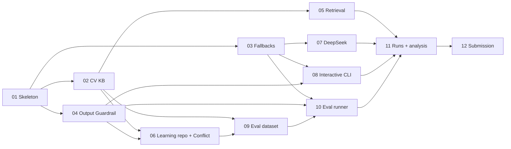

# Build plan: Interview Assistant

Status: approved 2026-10-04 (Gate 7)

Built from the approved [README](../../README.md) (revision 27), the [spec](spec.md) and the [tickets](../../tickets/). It adds nothing new to the design. Estimates come from the README's Deployment Plan build blocks; there is no time budget.

## 1. Tickets

| # | Ticket | What it delivers | Task | Blocked by | Estimate (min) | Acceptance criteria | Main risk |
|---|---|---|---|---|---|---|---|
| 01 | [Walking skeleton](../../tickets/01-walking-skeleton.md) | `./ask` end to end on fixture Entries, one Anthropic call, Sources, trace | T2, T4 | — | 90–120 | 7; `./ask` prints cited claims from fixtures | Spring Boot 4 + Spring AI 2.0.1 setup and structured output take longer than planned |
| 02 | [CV knowledge base](../../tickets/02-cv-knowledge-base.md) | Real CV Snapshot, reviewed Entries, startup checks, id diff | T1 | 01 | 80 | 7; startup stops on a mistyped Quote | Quote check fails on PDF text quirks (line breaks, ligatures) |
| 03 | [Fallbacks and failure paths](../../tickets/03-fallbacks-and-failure-paths.md) | Input Guardrail floor, `notInSources`, every failure → fixed message | T2, T4 | 01 | 50 *(estimate)* | 8; stub never called below the floor | Score floor can't be set until dev questions exist (set provisionally) |
| 04 | [Full Output Guardrail](../../tickets/04-full-output-guardrail.md) | Number, date, name checks, normalisation, drop ratio, removed line | T2 | 01 | 45 | 6; "Goldman" claim dropped | Normalisation either too loose or too strict |
| 05 | [Retrieval filters and expansion](../../tickets/05-retrieval-filters-and-expansion.md) | Employer, technology, type filters; role headers | T1 | 02 | 25 | 6; Tamara question retrieves only Tamara | Filters hide relevant Entries on vague questions |
| 06 | [Learning repo and the real Conflict](../../tickets/06-learning-repo-and-the-real-conflict.md) | Go prototypes Snapshot, Conflict record, notice rendering | T1 | 02, 04 | 40 | 7; languages question shows both sides | Conflict notice fires on unrelated questions |
| 07 | [DeepSeek adapter](../../tickets/07-deepseek-adapter-paid-vs-open-weights.md) | Paid vs open-weights experiment, cost and latency in traces | T2 | 03 | 30 | 6; same question answered by both providers | DeepSeek JSON mode returns empty or off-schema output often |
| 08 | [Interactive CLI](../../tickets/08-interactive-cli.md) | Session with suggested questions; rendered-output tests | T4 | 03, 04 | 30 | 6; fallbacks never show Sources | — |
| 09 | [Eval dataset](../../tickets/09-eval-dataset.md) | 30 verified questions and Gold Labels | T3 | 02, 06 | 60 | 6; every item `verified: true` | Subject review time; labels too strict |
| 10 | [Eval runner and scorer](../../tickets/10-eval-runner-and-scorer.md) | `./eval.sh`, 10 metrics, Hard Lines, baseline | T3 | 03, 04, 09 | 75 | 7; table printed, exit code on Hard Line only | Metric definitions disagree with the README |
| 11 | [Committed runs and error analysis](../../tickets/11-committed-runs-and-error-analysis.md) | Sonnet × 3, DeepSeek × 1, baseline; tagged failures; measured numbers | T3, T2 | 05, 07, 08, 10 | 60 | 6; ≥ 2 tagged failures committed | Provider rate limits during runs |
| 12 | [Submission](../../tickets/12-submission.md) | Run-from-README in < 10 min, Task 5 completed, tag | S, T5 | 11 | 30 | 5; fresh clone answers in < 10 min | Setup steps missing from the README |

Ticket-to-block mapping: 01 = blocks 1 + part of 4, 5 and 7; 02 = part of 2 + 3; 03 = part of 5 and 6 *(estimate)*; 04 = part of 6; 05 = rest of 4; 06 = rest of 2 + part of 6; 07 = rest of 5; 08 = rest of 7; 09 = 8; 10 = 9; 11 = 10; 12 = 11. Splitting the blocks into vertical slices adds about 45 minutes of glue and tests over the README's 585.

## 2. Order and critical path

- **Build order (frontier first):** 01 → 02 → 03 → 04 → 05 → 06 → 07 → 08 → 09 → 10 → 11 → 12.
- **Critical path:** 01 → 02 → 06 → 09 → 10 → 11 → 12, about 450 minutes. 04 must also land before 06.
- **Can run in parallel:** 03, 04 and 07 after 01; 05 after 02; 08 after 03 and 04; 05, 07 and 08 alongside 09–10.

## 3. Timeline

| After ticket | Cumulative (min) |
|---|---|
| 01 | 105 |
| 02 | 185 |
| 03 | 235 |
| 04 | 280 |
| 05 | 305 |
| 06 | 345 ← **checkpoint: the assistant is demonstrable** (Tasks 1, 2, 4: real Sources, cited answers, guardrails, Conflict, fallbacks) |
| 07 | 375 |
| 08 | 405 |
| 09 | 465 |
| 10 | 540 |
| 11 | 600 ← **checkpoint: evaluation deliverables complete** (Task 3) |
| 12 | 630 |

**Total: about 630 minutes (10.5 hours)**, using the midpoint of 01's range, plus the Subject's review time in 02, 06, 09, 11 and 12. No budget to cut to. If it runs long, the only deferrals are items the README already lists under Future Considerations; nothing in a ticket is cut.

## 4. Coverage check

| Brief deliverable or hard constraint | Ticket |
|---|---|
| What the assistant sees, how collected; storage, structure, maintenance | 02, 06 |
| Retrieval of relevant context | 01, 05 |
| Adding a Source without redesign | 02, 06 (second Source added as data) |
| One real Conflict and its behaviour | 06 |
| Redacted and synthetic | 02 |
| Why this architecture; retrieval, prompting, tool use | 01 (design in README) |
| Tracing facts to sources; behaviour when it can't | 01, 04 |
| Model choice and switch evidence | 07, 11 |
| Failure paths and deterministic fallback | 03 |
| Security and privacy; secrets; `.env.example` | 01, 07, 12 |
| Measured cost per question and p95 | 07, 11 |
| Production changes; 100× | README (design), 12 confirms |
| ≥ 20 labelled questions in five categories | 09 |
| One command that prints a table | 10 |
| Committed results with ≥ 2 failures; error analysis | 11 |
| Precisely defined metrics | 10 |
| Money movement and continuous running | README (design) |
| Interface with visible sources and fallback; interaction line | 01, 08 |
| Decision record, cuts, AI use, self-review, time | 12 (from every ticket's AI-usage entry) |
| Run in < 10 minutes; pinned dependencies; provider and eval cost named | 12 |
| Real commits; declared reuse; `submission` tag | every ticket commits; 12 |
| Hard constraint: never invent | 04, 06, 09, 10 |

Every deliverable maps to a ticket or to written design already in the README.

## 5. Preconditions

Before ticket 01:

- [ ] **Anthropic API key** with a monthly spend limit (about $10 covers development and every committed run), in `.env`
- [ ] **DeepSeek API key** with a small top-up (about $2), needed by ticket 07
- [ ] **JDK 21** installed (`java -version`); Maven comes with the wrapper
- [ ] The design files committed to the GitHub repository (README, ADRs, CONTEXT, docs, tickets) so tickets start from a clean tree
- [ ] The CV PDF and the learning repository available locally for ticket 02 and 06 Snapshots
- [ ] Decide whether `.idea/` belongs in `.gitignore` (it is staged now)

Creating the API keys and setting spend limits are steps only the Subject can take; the `wizard` skill can script them.

## 6. How each ticket runs

Default: a fresh context per ticket. `/clear`, then `/implement tickets/<NN>-<slug>.md`, which drives `/tdd` at the agreed seams and runs `/code-review` before committing. Commit at the end of each ticket, append its AI-usage entry, and record actual minutes next to the estimate in this file.

| # | Estimate | Actual |
|---|---|---|
| 01 | 90–120 | |
| 02 | 80 | |
| 03 | 50 | |
| 04 | 45 | |
| 05 | 25 | |
| 06 | 40 | |
| 07 | 30 | |
| 08 | 30 | |
| 09 | 60 | |
| 10 | 75 | |
| 11 | 60 | |
| 12 | 30 | |
| **Total** | **≈ 630** | |
